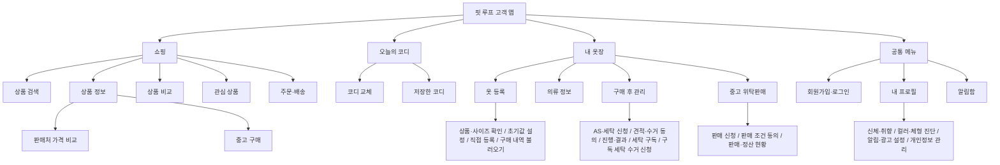

# 핏 루프

AI 기반 의류 추천·옷장 등록부터 코디·세탁 구독·브랜드 AS·중고 위탁판매까지 연결하는 서비스 기획. 고객 편의와 브랜드·매장의 광고·AS 운영 효율을 함께 고려한 구성.

## 프로젝트 목표

고객의 상품 비교·옷장 입력 부담 감소와 의류 활용 확대. 업체의 적합 고객 유입과 AS 접수·배정·안내·정산 업무 부담 완화. 추천·코디·관리·중고 위탁판매를 통한 재사용 연결.

## 핵심 사용자

온라인 의류 구매가 잦고, 브랜드별 사이즈 차이와 소재·착용감 선택에 어려움을 겪는 20~30대 사용자. 가진 옷의 코디와 세탁·수선 관리가 필요한 사용자, 유행이나 취향 변화로 기존 옷의 재판매를 원하는 사용자.

## 주요 기능

브리프의 내용 항목과 같은 순서로 구성.

| 번호 | 구분 | 기획 내용 |
|---|---|---|
| 1 | 신체 정보와 선택형 진단 | 가슴·허리 둘레, 어깨너비 등 측정 안내와 입력값 확인. 가입 시 치수·체형·퍼스널 컬러·선호 핏 등록과 추후 수정. 설문·사진 진단의 선택 진행 |
| 2 | 쇼핑과 사이즈 추천 | 같은 종류 상품의 선택 사이즈별 실측·혼용률·착용감 후기 비교. 로그인 후 추천 목록에 적합한 사이즈·색상·추천 근거 표시. 동일 모델·색상·사이즈의 쿠폰·배송비 포함 가격과 확인 시각 비교 |
| 3 | 오늘의 코디와 내 옷장 | AI 사진 검색·구매 내역·직접 입력으로 옷 등록. 최초 사용·세탁 상태를 반영한 옷장 초기값 설정. 날씨와 보유 의류를 반영한 코디 제안·교체·저장·조회 |
| 4 | 구매 후 관리 | 옷별 관리 안내·알림과 처리 기록. 일반 세탁·구독 세탁 수거 신청과 견적·수거 동의. 브랜드 AS 견적과 제휴 세탁 요금의 구분. 수거·작업·배송·예외 상태 확인 |
| **5** | **서비스 내 중고거래** | **내 옷장에서 판매 신청·수거 예약, 수거·검수 후 위탁판매. 판매 조건 확인과 판매자 동의 후 상품 등록, 서비스 내 구매와 판매·정산 상태 확인** |
| 6 | 메뉴와 정보 관리 | 하단 쇼핑·오늘의 코디·내 옷장, 상단 프로필 배치. 신체 정보·진단·취향·지역·알림 관리와 정보·사진 수정·삭제. 업체의 AS·광고·정산, 관리자의 승인과 IT 장애 대응 |

## 메뉴 구성

- 하단 메뉴: 쇼핑 / 오늘의 코디 / 내 옷장
- 상단 프로필: 신체 치수·진단·취향·지역·알림 관리
- 쇼핑: 상품 검색·정보·실측 및 소재 비교·판매처 가격 비교·중고 구매·관심 상품·주문 및 배송
- 오늘의 코디: 날씨·보유 의류 기반 추천, 코디 교체·저장·조회
- 내 옷장: 옷 등록·의류 정보·AS 및 세탁·세탁 구독·중고 위탁판매
- 공통: 회원가입·로그인·내 프로필·알림함

## 앱 구조도

고객 앱의 하단 메뉴 3개와 상단 프로필·알림함 중심 구성. 메뉴 소속 기준의 구조도이며 실제 이용 순서는 서비스 흐름도에서 확인.

| 운영 구분 | 큰 메뉴 | 하위 구성 |
|---|---|---|
| 업체 운영 웹 | 작업 | AS·세탁 접수·견적·배정·수거·검수, 중고 위탁판매 수거·검수·등록·배송·반송 |
| 업체 운영 웹 | 광고 | 광고 등록·AI 대상 제안·성과 및 집행 |
| 업체 운영 웹 | 정산 | 소속 업체 명세와 이의 내역 |
| 업체 운영 웹 | 공통 | 업체 로그인 |
| 관리자·IT 웹 | 관리 | 업체·권한, 광고·상품 승인, AI·데이터, 구독·결제, 통합 정산, 연동·접근 기록, 운영 예외 |
| 관리자·IT 웹 | 공통 | 운영 로그인 |

공개 상품 정보의 방문자 탐색 허용, 개인 맞춤 추천과 본인 주문·옷장 이용의 로그인 필요. 운영 로그인 후 소속·담당 역할에 따른 정보 접근. 진행 중인 AS·세탁·위탁판매의 중복 신청 및 해당 의류 삭제 제한.

## 중고 위탁판매 기획

브리프의 5번 항목에 서비스 내 중고거래 배치. 판매 신청 → 수거 예약 → 검수 → 판매 조건 확인·동의 → 상품 등록 → 구매·판매 → 정산 흐름.

상품의 현재 실측·상태와 판매자가 공개에 동의한 관리 기록 제공. 판매 불가 시 반송 조건·수수료와 정산 기준의 사전 안내. 구매 확정 후 구매자의 정보 확인을 거친 내 옷장 등록과 코디·관리 연결. 판매 완료 의류의 이후 코디 추천 제외.

수거·검수·보관·배송·반송 운영 비용의 확인 필요. 검수 범위와 상태 표시, 반품·정산 처리 기준의 구체화 대상.

## 세탁 관리 기획

[런드리고](https://www.laundrygo.com/)의 모바일 세탁 신청과 문 앞 수거·배송 흐름 참고. 제품별 세탁 라벨과 브랜드 지침을 기준으로 한 관리 안내, 알림 미루기·끄기 제공.

예약·할인·처리 상태 자동 연동은 업체 제휴 후 적용 계획. 미연동 업체는 공식 접수처 연결과 직접 기록 방식. 배송비 포함 견적 비교와 묶음 수거·제휴 할인 검토.

구독 세탁 신청 시 의류·주소·수거 일정 선택과 남은 혜택·예상 차감·초과 비용 확인. 신청 단계의 이용 횟수 임시 확보, 담당자 확인과 고객 동의 후 수거 확정 시 1회 차감. 확정 전 취소·수거 실패 시 임시 확보 횟수 복원, 확정 후 취소의 정책 적용.

브랜드 AS 견적과 제휴 세탁 접수·요금의 별도 처리. 비용·작업 조건 변경 시 고객 재동의. 파손·분실·반품·분쟁의 담당자 배정과 고객 안내·정산 조정, 해결 전 관련 정산 보류.

왁스 제품은 일반 세탁과 구분. 리왁싱·특수 관리·브랜드 AS 가능 여부의 업체 확인. 관리 보장·최저가·무상 AS의 확정 약속 제외.

## AI와 옷장 초기값

**옷 사진 촬영 → AI 상품 후보 검색 → 사용자 일치 확인 → 사이즈 선택 → 최초 사용 상태 선택 → 옷장 초기값 설정.**

구매 내역 등록 시 구매 확정한 본인 주문과 실제 연동된 외부 주문의 품목 선택·정보 확인·저장. 같은 주문 품목의 중복 등록 확인과 기존 옷 연결. 미연동 구매의 사진·직접 입력 대안.

초기 사용·세탁·건조 상태는 선택 입력. 소재·공식 실측·확보한 검증 자료를 바탕으로 최초 치수 변화 범위 추정, 공식 실측과 추정 초기값의 분리 표시. 모름·자료 부족 시 추정 보류와 직접 수정 제공. 직접 측정값의 우선 반영.

등록 이후의 치수 변화 추적이나 반복 세탁 입력 제외. 관리 서비스의 처리·배송 기록과 옷 치수 추적의 구분.

AI 사용 부분: 사진 상품 검색·초기 치수 추정, 사이즈·상품·코디 추천, 맞춤 광고 대상 추천, AS 접수 정보 정리·작업 분류 보조. 상품 일치 여부는 고객 확인, AS 조건·견적·실물 검수는 담당자 최종 확인. AI 정확도·일률적인 수축량·정품 판별 보장 제외.

## 고객과 업체 운영

**서비스 흐름도 설계 비중: 고객 30%, 매장 직원·브랜드·매장 매니저·관리자·IT팀 70%.** 실제 이용자 수나 매출 비율과 구분. 흐름도별 고객 3단계·업체 운영 7단계, 예외 처리 별도 표시.

| 대상 | 주요 역할 |
|---|---|
| 고객 | 신체·옷장 초기 정보 등록, 추천 확인, 견적·판매 조건 동의와 결과 확인 |
| 매장 직원 | 접수·증빙·실물 확인, 수거·작업·인계 상태 기록 |
| 브랜드 | AS 가능 범위·단가·기간 확인, 광고 상품·예산·기간 설정 |
| 매장 매니저 | 작업 배정·기한·품질 관리, 광고 예산 조정과 지연·반송 대응 |
| 관리자·IT팀 | 업체·광고 승인, 구독·정산 대조, 업무별 권한·AI·데이터·제휴 연동·장애 대응 |

## 수익구조

| 수익원 | 비용 부담 대상과 제공 가치 |
|---|---|
| 업체 광고비 | 브랜드·매장의 예산에 따른 맞춤 광고 집행과 성과 확인 |
| 업체 AS 업무 대행료 | 브랜드·매장의 접수·고객 안내·수거·작업 연결·정산 업무 대행 |
| 세탁 구독료 | 고객의 정기 세탁 이용과 구독 혜택 |

낮은 AS 비용은 원가 절감 목표. 업체의 기존 비용과 대행 비용 비교를 통한 검증. 세탁비·부품·인건비·배송비·재작업비·AI 운영비를 포함한 수익성 확인 후 요금 결정. 구독 포함 횟수·초과 이용·해지 정산 기준의 확정 필요.

광고 상품·예산·기간 등록 → 관리자 심사 → AI 대상 제안 → 승인·노출 → 성과 확인·광고비 정산. 일반 추천과 광고 표시 구분, 맞춤 광고 설정·해제 제공, 원본 신체 정보의 업체 일괄 공유 제외.

## 벤치마킹 기준

의류 플랫폼 무신사·4910·29CM와 런드리고의 공개 서비스 참고. 기획·디자인·UI UX·BM·기술·콘텐츠의 여섯 관점으로 비교, 확인된 참고 기능과 핏 루프의 적용 제안 구분.

- 기획: 고객과 업체의 문제, 구매 전후 연결 방식.
- 디자인: 상품 사진·실측·상태·광고 표시와 작업 현황의 정보 우선순위.
- UI UX: 옷 등록·신청 단계 감소, 담당자 인계와 예외 처리.
- BM: 업체 광고·AS 대행·세탁 구독 수익과 실제 비용.
- 기술: AI 추천·사진 검색·초기값, 운영자 확인·제휴 연동·오류 대응.
- 콘텐츠: 추천 이유·소재·관리법·검수 상태·AS 조건·광고 성과.

## 과제 파일

| 과제 | 파일 | 형식 |
|---|---|---|
| 브리프 | [의류추천_팀프로젝트_브리프.docx](의류추천_팀프로젝트_브리프.docx) | Word |
| SWOT | [의류추천_팀프로젝트_SWOT.docx](의류추천_팀프로젝트_SWOT.docx) | Word |
| 페르소나 | [의류추천_팀프로젝트_페르소나.pptx](의류추천_팀프로젝트_페르소나.pptx) | PowerPoint |
| 벤치마킹·운영 기획 | [핏루프_벤치마킹_운영기획.docx](핏루프_벤치마킹_운영기획.docx) | Word |
| 서비스 흐름도 | [핏루프_서비스흐름도.pptx](핏루프_서비스흐름도.pptx) | PowerPoint |
| 기능규격 수정본 | [핏루프_기능규격 수정.xlsx](https://github.com/chaealex/AIserviceDEV/blob/main/%E1%84%91%E1%85%B5%E1%86%BA%E1%84%85%E1%85%AE%E1%84%91%E1%85%B3_%E1%84%80%E1%85%B5%E1%84%82%E1%85%B3%E1%86%BC%E1%84%80%E1%85%B2%E1%84%80%E1%85%A7%E1%86%A8%20%E1%84%89%E1%85%AE%E1%84%8C%E1%85%A5%E1%86%BC.xlsx) | Excel |
| IA 수정본 | [핏루프_IA 수정.xlsx](https://github.com/chaealex/AIserviceDEV/blob/main/%E1%84%91%E1%85%B5%E1%86%BA%E1%84%85%E1%85%AE%E1%84%91%E1%85%B3_IA%20%E1%84%89%E1%85%AE%E1%84%8C%E1%85%A5%E1%86%BC.xlsx) | Excel |

기존 중간 발표 과제 양식 적용, 중요 부분의 노란 형광 밑줄. 고객·매장 직원·브랜드 및 매니저·관리자 및 IT 담당자 페르소나는 모두 가상 인물 설정.

현재 작성 범위: 브리프·SWOT·페르소나·벤치마킹 및 운영 기획·서비스 흐름도·기능규격·IA. 사이트맵 별도 과제·와이어프레임·스토리보드의 후속 작성 예정.

## 팀원

| 이름 | 학번 |
|---|---|
| 채형민 | 202404318 |
| 이승민 | 202404270 |
| 지승민 | 202202460 |

## 참고 자료

- [무신사 사이즈 측정법](https://store.musinsa.com/app/product/real_size)
- [무신사 유즈드 론칭 안내](https://www.musinsa.com/content/1409394122235623454)
- [4910 스쿼드 이야기](https://ably.team/news/aDguUBEAACoAlJZJ)
- [29CM](https://home.29cm.co.kr/)
- [런드리고](https://www.laundrygo.com/)
- [바버 왁스 재킷 관리 안내](https://www.barbour.com/gb/blog/wax-care/how-to-clean-a-barbour-jacket.html)

- [무신사 상품 광고 안내](https://musinsabiz.oopy.io/185c899e-bf92-8045-a3bd-dd44aa006b96)
- [4910 광고 노출 방식](https://4910ads.oopy.io/product3)
- [런드리고 가격표](https://app.laundrygo.com/guide/price)

작성 기준일: 2026년 11월 18일

## 기능규격과 IA

2026년 11월 17일 업로드된 수정본 기준. **기능규격 48개 항목·IA 71개 화면**. 고객 앱·웹, 업체 운영 웹, 관리자·IT 웹의 1~3 Depth와 유형·데이터타입·권한정책 구성.

기존 42개 기능·65개 화면에서 추가된 내용:

| 구분 | 추가 내용 |
|---|---|
| 상품 비교 | 같은 종류 상품의 선택 사이즈 실측·소재 혼용률·착용감 후기 비교, 측정 기준 차이와 누락 정보 표시 |
| 구매 내역 등록 | 구매 확정한 본인 주문·연동 외부 주문의 옷장 등록, 사용자 정보 확인과 중복 등록 방지 |
| 코디 저장 | 제안·교체한 코디 저장·조회·삭제, 판매·삭제 의류 표시와 교체 |
| 구독 세탁 수거 | 남은 혜택·예상 차감·초과 비용 확인과 수거 신청, 수거 확정 시 1회 차감 |
| 업체 세탁 접수 | 소재·수거 일정·구독 적용·초과 비용 확인, 조건 변경 시 고객 재동의 |
| 운영 예외 | AS·세탁·위탁판매의 파손·분실·반품·분쟁 처리, 고객 안내와 정산 조정 |

- [기능규격 수정본](https://github.com/chaealex/AIserviceDEV/blob/main/%E1%84%91%E1%85%B5%E1%86%BA%E1%84%85%E1%85%AE%E1%84%91%E1%85%B3_%E1%84%80%E1%85%B5%E1%84%82%E1%85%B3%E1%86%BC%E1%84%80%E1%85%B2%E1%84%80%E1%85%A7%E1%86%A8%20%E1%84%89%E1%85%AE%E1%84%8C%E1%85%A5%E1%86%BC.xlsx)
- [IA 수정본](https://github.com/chaealex/AIserviceDEV/blob/main/%E1%84%91%E1%85%B5%E1%86%BA%E1%84%85%E1%85%AE%E1%84%91%E1%85%B3_IA%20%E1%84%89%E1%85%AE%E1%84%8C%E1%85%A5%E1%86%BC.xlsx)

수정본의 우선 참고. 기존 `4.핏루프_기능규격.xlsx`와 `5.핏루프_IA.xlsx`는 이전 버전 보관.
